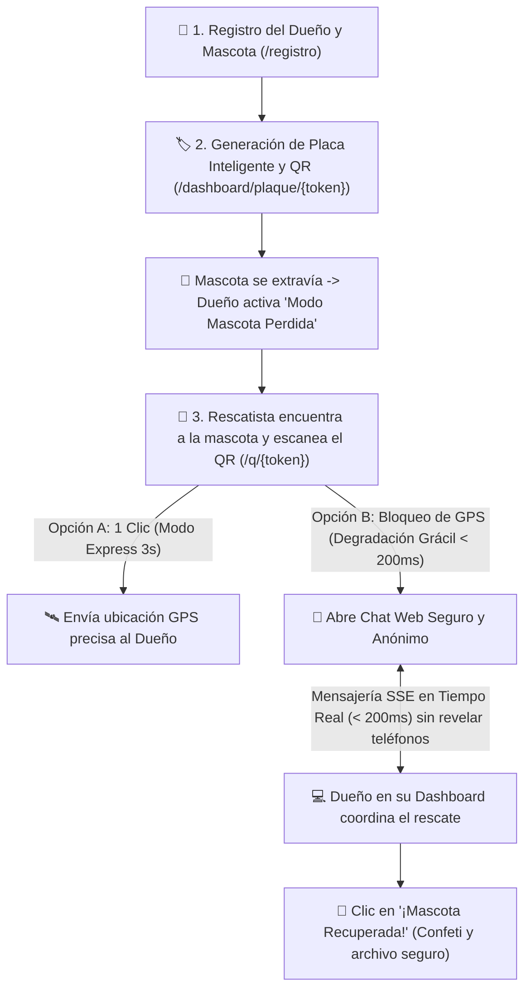

# 🐾 PetCode — Sistema Web de Identificación Inteligente y Rescate de Mascotas

[](IEEE_830_AUDIT_REPORT.md)
[](IEEE_830_AUDIT_REPORT.md)
[](IEEE_830_AUDIT_REPORT.md)
[-brightgreen.svg)](tests/)
[](https://fastapi.tiangolo.com)
[](LICENSE)

**PetCode** es una plataforma web *mobile-first* diseñada para el rescate y retorno seguro de mascotas extraviadas mediante **placas inteligentes QR** y comunicación en tiempo real. 

El sistema implementa una **política estricta Anti-Doxxing**: bajo ninguna circunstancia se expone el número telefónico personal ni la dirección de residencia del propietario a extraños.

---

## 🌟 Flujo Principal del Sistema



1. **¿Quién eres y tu mascota?** (`/registro` o `/`):
   - El propietario indica su nombre o alias, su teléfono de contacto y correo (almacenados con cifrado y confidencialidad).
   - Ingresa los datos de su mascota (nombre, especie, raza, foto/avatar y notas médicas como alergias o medicamentos).
   - Genera inmediatamente su **Placa Inteligente con código QR** único.
2. **Placa Inteligente Imprimible** (`/dashboard/plaque/{token}`):
   - Plantilla lista para imprimir o grabar para el collar de la mascota.
3. **Ficha Pública de Emergencia** (`/q/{token}`):
   - Acceso ultraliviano (FCP < 1.2s en 4G) sin necesidad de instalar apps.
   - **Modo Express (3s)**: Botón *"Enviar mi ubicación satelital al dueño y retirarme"* (POST `/api/v1/scans` en < 1.5s).
   - **Degradación Grácil**: Si el GPS es rechazado, en menos de 50 ms despliega el buscador manual y acceso directo al chat seguro sin errores en consola ni modales bloqueantes.
4. **Chat Web Efímero y Anónimo** (`/chat/{session_token}` y `/simulador/{token}`):
   - Comunicación bidireccional en tiempo real mediante **Server-Sent Events (SSE)** con latencia < 200 ms.
   - Identidades enmascaradas: *"Rescatista"* y *"Dueño de [Mascota]"*.
   - Envío de fotografías comprimidas en cliente (< 1.5 MB) y coordenadas GPS.
   - Sanitización estricta contra inyecciones XSS.
5. **Dashboard del Propietario** (`/dashboard`):
   - Geovisor satelital con **Leaflet / OpenStreetMap** mostrando la última ubicación reportada y su **círculo de radio de incertidumbre (metros)**.
   - Switch de estado: `🏠 En Casa` vs. `🚨 Mascota Perdida`.
   - Bandeja de chats activos con aviso sonoro y visual de nuevos mensajes.
   - Botón *"¡Mascota Recuperada!"* que desactiva la alerta, archiva las conversaciones y lanza animación de confeti en Canvas.

---

## 🔒 Política de Privacidad Anti-Doxxing (OWASP ASVS)

* **Teléfono del Dueño**: **NUNCA** se transmite en el DOM, HTML, comentarios ni respuestas JSON públicas (`GET /api/v1/pets/public/{token}`).
* **Dirección Residencial**: **NUNCA** figura en ningún recurso accesible públicamente.
* **Rescatista**: **CERO** solicitud de datos personales (sin login, sin correo, sin teléfono).
* **Purga Automática (TTL 7 Días)**: Tarea programada que elimina coordenadas satelitales exactas y mensajes de chat tras 7 días de inactividad.
* **Rate Limiting Perimetral**: Máximo 3 peticiones POST a `/api/v1/scans` cada 10 minutos por IP y token de placa (la 4.ª retorna `HTTP 429 Too Many Requests`).

---

## 🧪 Certificación Formal IEEE Std 830-1998

Se ejecutó la suite de 18 pruebas automatizadas bajo Pytest con un resultado de **100% PASS**:

| Requisito IEEE 830 | Test ID | Criterio Verificado | Estado |
|---|---|---|:---:|
| `RF-RES-01` | `TEST-PRIV-01` / `TEST-A11Y-01` | Ficha pública con badge médico, sin fugas PII y botones >= 48px | **✅ PASS** |
| `RF-RES-02 (CA1)` | `TEST-GEO-02` | Modo Express GPS en 1 Clic en < 1.5s | **✅ PASS** |
| `RF-RES-02 (CA2)` | `TEST-GEO-01` | Degradación Grácil ante bloqueo GPS en < 200 ms | **✅ PASS** |
| `RF-CHAT-01 (CA1-3)`| `TEST-CHAT-01` | Chat Anónimo SSE con latencia < 200 ms | **✅ PASS** |
| `RF-CHAT-01 (CA3)` | `TEST-CHAT-02` | Reconexión transparente ante caídas de red | **✅ PASS** |
| `RF-CHAT-01 (CA4)` | `TEST-CHAT-03` | Sanitización y neutralización de XSS | **✅ PASS** |
| `RS-SEC-01` | `TEST-PRIV-01` | Cero Doxxing (0 teléfonos o direcciones expuestas) | **✅ PASS** |
| `RF-API-01 (CA2)` | `TEST-SEC-01` | Rate Limiting perimetral (HTTP 429 en 4ª petición) | **✅ PASS** |
| `RNF-A11Y` | `TEST-A11Y-01` | Accesibilidad WCAG 2.1 AA y Touch Targets >= 48x48px | **✅ PASS** |

---

## 🚀 Instalación y Puesta en Marcha

### Prerrequisitos:
- Python 3.11 o superior (recomendado Python 3.14).

### 1. Clonar el repositorio:
```bash
git clone https://github.com/tu-usuario/petcode.git
cd petcode
```

### 2. Crear y activar entorno virtual:
```bash
python -m venv .venv
# En Windows (PowerShell):
.venv\Scripts\Activate.ps1
# En Linux / macOS:
source .venv/bin/activate
```

### 3. Instalar dependencias:
```bash
pip install fastapi uvicorn jinja2 pydantic pydantic-settings httpx pytest pytest-asyncio beautifulsoup4
```

### 4. Iniciar el servidor:
```bash
# Opción directa en Windows: doble clic en iniciar_servidor.bat
# O mediante terminal:
python -m uvicorn app.main:app --reload --host 127.0.0.1 --port 8000
```

### 5. Abrir en el navegador:
* **Registro de Mascota**: [http://127.0.0.1:8000/registro](http://127.0.0.1:8000/registro)
* **Dashboard del Propietario**: [http://127.0.0.1:8000/dashboard](http://127.0.0.1:8000/dashboard)
* **Simulador de Chat en Vivo (Pantalla Dividida)**: [http://127.0.0.1:8000/simulador/LUNA-COL-99](http://127.0.0.1:8000/simulador/LUNA-COL-99)
* **Ficha Pública de Rescate**: [http://127.0.0.1:8000/q/LUNA-COL-99](http://127.0.0.1:8000/q/LUNA-COL-99)
* **Placa QR Imprimible**: [http://127.0.0.1:8000/dashboard/plaque/LUNA-COL-99](http://127.0.0.1:8000/dashboard/plaque/LUNA-COL-99)
* **Documentación OpenAPI / Swagger**: [http://127.0.0.1:8000/docs](http://127.0.0.1:8000/docs)

---

## 🧪 Ejecución de Auditoría y Pruebas

Para re-ejecutar toda la batería de certificación:
```bash
python run_ieee_audit.py
```

---

## 📄 Licencia
Este proyecto está bajo la Licencia MIT.

